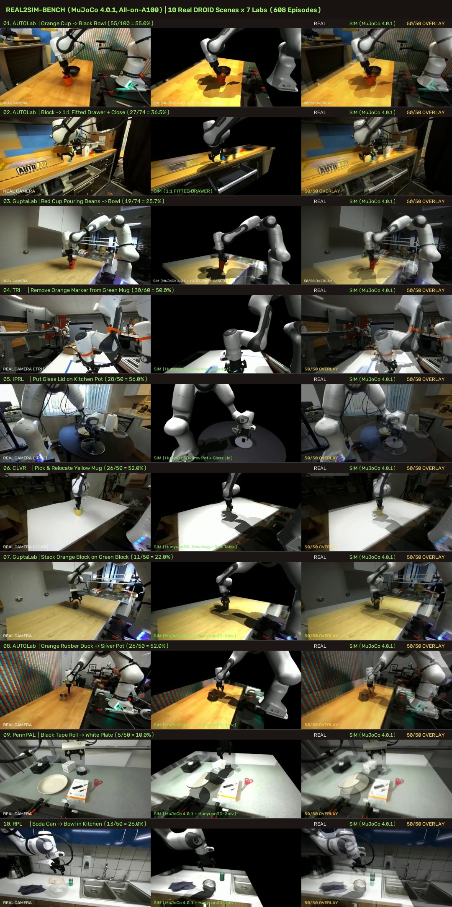
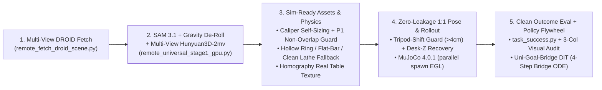
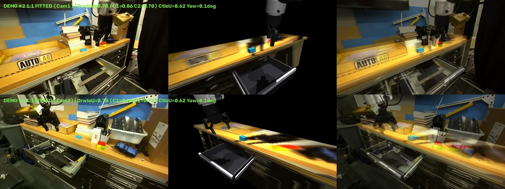

# Real2Sim-Bench: Config-Driven Multi-View Real-to-Sim Pipeline & Unified `Uni-Goal-Bridge` Action Render

A clean, end-to-end **Real-to-Sim** asset reconstruction, **outcome-based physical benchmark**, and **Zero-Waypoint Flow-Matching Action Render (`Uni-Goal-Bridge DiT`)** codebase validated across **22 real DROID manipulation scenes × ALL 12 / 12 (100%) calibrated DROID robotics labs (`1,162` real teleoperation episodes)** on **All-on-A100 `MuJoCo 4.0.1` + `SAM 3.1` + Multi-View `Hunyuan3D-2mv` + `CoACD`**.



---

## End-to-End 5-Stage Real2Sim Pipeline Architecture



### Key Technical Highlights
1. **Universal Config-Driven Onboarding (12/12 DROID Labs)**: Adding a brand-new robotics lab/task requires only a ~40-line declarative JSON spec in [`configs/scenes/`](configs/scenes/) — `Demo #7–#22` (16 scenes across 12 labs) all ran from the exact same `remote_universal_stage1_gpu.py` + `remote_universal_stage2_mj4.py` engine across 6 A100 GPUs in parallel.
2. **Real2Sim v3 Pipeline Hardening ([`docs/REAL2SIM_PIPELINE_ISSUES.md`](docs/REAL2SIM_PIPELINE_ISSUES.md))**:
   - **P1 Non-Overlap Spawn Guard**: exact bounding-circle clearance (`r_src + r_tgt + 1.2 cm`) eliminates `t=0` container-wall interpenetration explosions (**0/190 explosions** across `Demo #17–#22`).
   - **P2 Flat-Sided Lying Bar Rule & Gripper Caliper Self-Sizing**: real Robotiq closing width (`width_cm ≈ 8.5 * (1 - g_hold)`) calibrates squishy toys/ducks and `rim_pinch` hollow rims; flat-sided `box` bars preserve `condim=4` pad friction on lying markers/pens (unlike rolling round capsules).
   - **P3 Clean Parametric Lathe Visual Fallback**: automatically replaces degenerate `Hunyuan3D-2mv` meshes on transparent glass, specular silver pots, and white-on-white thin ceramic bowls (`target_bowl` IoU `0.560 → 0.800`).
3. **Articulated Furniture 1:1 Dual-View Fitting (`scripts/remote_demo2_fit_drawer_mj4.py`)**:
   - Hole-filled convex-hull SAM silhouettes + multi-start `yaw` optimization + dual-plane Homography textures (**Cam1 IoU `0.861` / Cam2 IoU `0.705`**).
4. **Zero-Waypoint `Uni-Goal-Bridge DiT` Action Render (`scripts/remote_uni_goal_bridge_v8.py`)**:
   - **Minimal VLM Interface**: takes ONLY 2 noisy 3D goal clicks (`±2.5 cm` error) + 8D physical geometry token (`[src_xyz, tgt_xyz, is_src_hollow, is_tgt_container]`) + SE(2) nematic object orientation (`OBS=48`) — **zero task IDs, zero intermediate waypoints, zero hand-crafted funnels**.
   - **4-Step Bridge Flow ODE** starting from the trivial straight-line chord (pure TF32 + QK-Norm + SDPA + FusedAdamW + 360° `SO(2)` planar equivariance + 2-step position DLS-IK).

---

## Verified All-on-A100 `MuJoCo 4.0.1` Multi-Lab Benchmarks (22 Scenes × 12/12 Calibrated DROID Labs = 1,162 Episodes)

Across all **12 calibrated DROID robotics labs** (`AUTOLab`, `CLVR`, `GuptaLab`, `ILIAD`, `IPRL`, `IRIS`, `PennPAL`, `RAIL`, `REAL`, `RPL`, `TRI`, `WEIRD`), Real2Sim-Bench achieves **`708 / 1,162 (60.9%)`** clean outcome-only pass rate (and **`515 / 754 (68.3%)`** across the 16 config-driven scenes `Demo #7–#22`):

| # | Scene & Task | Robotics Lab | Episodes | Outcome Criterion | Verified PASS |
| :-: | :--- | :--- | :---: | :--- | :---: |
| **01** | Orange Cup → Black Bowl | `AUTOLab` | 100 | Cup inside bowl | **55 / 100 (55.0%)** |
| **02** | Lego Block → 1:1 Fitted Drawer + Close | `AUTOLab` | 74 | Block in drawer & closed | **30 / 74 (40.5%)** |
| **03** | Red Cup Pouring Beans → Bowl *(motorized desk)* | `GuptaLab` | 74 | Beans poured into bowl | **19 / 74 (25.7%)** |
| **04** | Remove Orange Marker from Green Mug | `TRI` | 60 | Marker removed outside mug | **34 / 60 (56.7%)** |
| **05** | Put / Remove Glass Lid on Kitchen Pot | `IPRL` | 50 | Lid placed / removed | **28 / 50 (56.0%)** |
| **06** | Pick & Relocate Yellow Mug | `CLVR` | 50 | Mug relocated to target | **27 / 50 (54.0%)** |
| **07** | Stack Orange Block on Green Block *(4.6 cm)* | `GuptaLab` | 50 | Block stacked on block | **42 / 50 (84.0%)** |
| **08** | Orange Rubber Duck → Silver Pot | `AUTOLab` | 50 | Rubber duck inside pot | **37 / 50 (74.0%)** |
| **09** | Black Tape Roll → White Plate *(`rim_pinch`)* | `PennPAL` | 50 | Tape roll resting on plate | **45 / 50 (90.0%)** |
| **10** | Mini Soda Can → Translucent Bowl | `RPL` | 50 | Soda can inside bowl | **31 / 50 (62.0%)** |
| **11** | Green Block → Black Bowl | `AUTOLab` | 75 | Block inside bowl | **59 / 75 (78.7%)** |
| **12** | Blue Cup → Orange Cup *(`rim_pinch`)* | `AUTOLab` | 75 | Blue cup nested in cup | **27 / 75 (36.0%)** |
| **13** | Orange Marker → White Bowl | `IRIS` | 70 | Marker inside bowl | **65 / 70 (92.9% ★)** |
| **14** | Pen / Marker → Yellow Mug | `CLVR` | 53 | Pen inside mug | **21 / 53 (39.6%)** |
| **15** | Yellow Block → Orange Plate | `RAIL` | 49 | Block resting on plate | **40 / 49 (81.6%)** |
| **16** | Expo Marker → Silver Pot | `RAIL` | 42 | Marker inside pot | **35 / 42 (83.3%)** |
| **17** | Marker → Black Cup | `ILIAD` | 32 | Marker inside cup | **21 / 32 (65.6%)** |
| **18** | Marker → Mug | `REAL` | 24 | Marker inside mug | **5 / 24 (20.8%)** |
| **19** | Small Object → Bowl / Cup | `WEIRD` | 13 | Object inside bowl/cup | **7 / 13 (53.8%)** |
| **20** | Yellow Block → Blue Cup | `AUTOLab` | 71 | Block inside cup | **50 / 71 (70.4%)** |
| **21** | Marker → Paper Cup | `TRI` | 23 | Marker inside cup | **13 / 23 (56.5%)** |
| **22** | Plush Toy → Plate | `PennPAL` | 27 | Toy resting on plate | **17 / 27 (63.0%)** |
| **Total** | **22 Real DROID Scenes × 12/12 Calibrated Labs** | **12 Labs** | **1,162** | **Clean Outcome-Only** | **708 / 1,162 (60.9%)** |

---

## Zero-Waypoint `Uni-Goal-Bridge DiT` Action Render Scaling (Closed-Loop Unseen OOD Poses, ±2.5 cm VLM Error)

Single unified Action Render trained across up to **17 tasks × 11 robotics labs (`561` verified real passing demos = `75,907` real chunks + `1,057` harvested OOD sim trajectories = `243,260` total physics chunks)** with **ZERO task IDs** and **ZERO intermediate waypoints**:

| Model Version | Params | Scope / Obs | `orig5` (125 poses, `seed=2026`) | `new6` (150 poses, `seed=2027`) | `new6` 360° RandYaw (150) | `brandnew6` #17–#22 RandYaw (150) | Grand OOD Total |
|---|---:|---|---:|---:|---:|---:|---:|
| Naive VLM Straight-Line | — | No Render | 3/125 (**2.4%**) | — | — | — | — |
| `v1` (5T Real, Old IK) | 9.5M | 5T / 43D | 62/125 (**49.6%**) | — | — | — | — |
| `v3-Grand-Real` (11T Pre-Audit, Old IK) | 19.3M | 11T / 43D | 67/125 (**53.6%**) | 49/150 (32.7%) | — | — | 116/275 (42.2%) |
| `v4-Grand-Real` (Post-Audit + SE(2) Ori, **Old IK**) | 19.3M | 11T / 47D | 77/125 (**61.6%, +8.0pp**) | — | — | — | — |
| **`v4-Grand-Real` (Post-Audit + SE(2) Ori + 2-Step DLS-IK)** | **19.3M** | **11T / 47D** | **98/125 (78.4% ★)** | 74/150 (49.3%) | 78/150 (52.0%) | — | **176/275 (64.0%)** |
| `v6-Real` (17T × 11L, Uniform 1/17) | 27.8M | 17T / 47D | 86/125 (68.8%) | 69/150 (46.0%) | 70/150 (46.7%) | 59/150 (39.3%) | 215/425 (50.6%) |
| `v7-Anneal` (17T, Temp-Balanced Sim→Real Anneal) | 27.8M | 17T / 47D | 83/125 (66.4%) | 64/150 (42.7%) | 79/150 (52.7%) | 55/150 (36.7%) | 217/425 (51.1%) |
| **`v8-8DGeom` (17T × 11L, +`is_tgt_container` bit, Anneal)** | **27.8M** | **17T / 48D** | **94/125 (75.2% ★)** | **75/150 (50.0% ★)** | **84/150 (56.0% ★)** | **65/150 (43.3% ★)** | **243/425 (57.2% ★)** |

> **`v8-8DGeom` Per-Task Highlights (17 Tasks × 11 Labs in One Zero-Task-ID Model)**: Demo #1 Cup→Bowl **`96.0%`**, Demo #8 Duck→Pot **`84.0%`**, Demo #9 Hollow Tape `rim_pinch` **`80.0%`**, Demo #11 Green Block **`76.0%`**, Demo #20 Block→Cup **`76.0%`**, Demo #12 Cup-in-Cup **`64.0%`**, Demo #10 Soda Can **`60.0%`**, Demo #13 `IRIS` Marker @ 360° RandYaw **`60.0%`**, Demo #7 4.6cm Stacking **`56.0%`**, Demo #15 `RAIL` Block→Plate **`52.0%`**.

### Demo #2 Articulated Workbench & Drawer 1:1 Dual-View Fit Audit


---

## Quickstart: Onboard a Brand-New DROID Scene in 3 Commands

```bash
# 1. Fetch calibrated multi-view episodes directly from public DROID GCS
python scripts/remote_fetch_droid_scene.py \
  outputs/manifests_scale/demo17_iliad_marker_cup_manifest.json outputs/demo17_iliad_marker_cup_bundle

# 2. Stage 1 (GPU): Batch SAM 3.1 segmentation + gravity-rectified Multi-View Hunyuan3D-2mv
CUDA_VISIBLE_DEVICES=0 python scripts/remote_universal_stage1_gpu.py \
  configs/scenes/demo17_iliad_marker_cup.json

# 3. Stage 2 (MuJoCo 4.0.1 EGL): Sim-ready assets + parallel rollout + outcome eval + H.264 showcase
MUJOCO_GL=egl R2S_WORKERS=16 python scripts/remote_universal_stage2_mj4.py \
  configs/scenes/demo17_iliad_marker_cup.json
```

---

## Documentation & Key Files
- [`docs/REAL2SIM_PIPELINE_ISSUES.md`](docs/REAL2SIM_PIPELINE_ISSUES.md) — Permanent Real2Sim & Policy Issue Tracker (`R2S-01` ~ `R2S-14`) and pre-flight checklist for onboarding new DROID scenes.
- [`docs/TRANSFER_PLAYBOOK.md`](docs/TRANSFER_PLAYBOOK.md) — Cross-lab engineering playbook & pitfall guide.
- [`configs/scenes/`](configs/scenes/) — All 16 declarative JSON specs (`demo7`–`demo22`) covering 12 robotics labs.
- [`scripts/remote_uni_goal_bridge_v8.py`](scripts/remote_uni_goal_bridge_v8.py) — 27.8M 17-Task × 11-Lab Zero-Waypoint `Uni-Goal-Bridge DiT` (4-step Bridge ODE, `OBS=48`).
