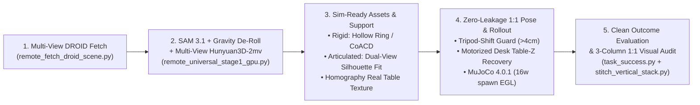

# Real2Sim-Bench: Config-Driven Multi-View Real-to-Sim Pipeline & Multi-Lab Benchmark

A clean, end-to-end **Real-to-Sim** asset reconstruction and **outcome-based physical evaluation** codebase validated across **10 real DROID manipulation scenes × 7 independent robotics labs (608 real teleoperation episodes)** on **All-on-A100 `MuJoCo 4.0.1` + `SAM 3.1` + Multi-View `Hunyuan3D-2mv` + `CoACD`**.


---

## End-to-End 5-Stage Pipeline Architecture



### Key Technical Highlights
1. **Universal Config-Driven Onboarding**: Adding a brand-new robotics lab/task requires only a ~30-line declarative JSON spec in [`configs/scenes/`](configs/scenes/) — no bespoke simulation scripts needed (`Demo #7–#10` all ran zero-shot from the exact same `remote_universal_stage1_gpu.py` + `remote_universal_stage2_mj4.py` engine across 4 A100 GPUs in parallel).
2. **Multi-View `Hunyuan3D-2mv` + Decoupled Sim-Ready Geometry (`r2s_bench/assets/sim_ready_pipeline.py`)**:
   - Extrinsic gravity de-rolling of Cam1 + Cam2 RGBA cutouts before multi-view 3D generation.
   - `auto_upright_pca=False` preserves gravity-aligned orientation for flat pans and side-handled mugs.
   - Decoupled visual mesh + guaranteed-hollow 16-facet cavity collision eliminates genus-1 CoACD bridging while keeping visual fidelity 1:1.
3. **Articulated Furniture 1:1 Dual-View Fitting (`scripts/remote_demo2_fit_drawer_mj4.py`)**:
   - Hole-filled convex-hull SAM drawer silhouettes + unconstrained multi-start `yaw` optimization + dual-plane Homography textures (countertop + steel cabinet), achieving **Cam1 IoU `0.861` / Cam2 IoU `0.705`**.
4. **Robotiq 2F-85 Closed-Linkage Calibration & Cross-Lab Robustness (`r2s_bench/pipeline/scene_transfer.py`)**:
   - Pre-settled silicone-pad FK accounting for the `-1.34 cm` 4-bar parallel linkage swing and `2.10 cm` minimum closed pad gap.
   - Automatic `>4 cm` camera tripod-shift guard (`select_camera_extrinsics`) and pure Frame-0 dual-view 3D triangulation (`triangulate_two_views`) for height-adjustable desks.
5. **Clean Outcome-Only Task Predicates (`r2s_bench/eval/task_success.py`)**:
   - One clear end-state outcome predicate per task (`object_in_container`, `object_out_of_container`, `object_on_target`, `joint_state`, `particles_in_target`, `block_in_drawer`) + numerical explosion guard (no brittle process-policing thresholds).

---

## Verified All-on-A100 `MuJoCo 4.0.1` Multi-Lab Benchmarks (10 Scenes × 7 Labs = 608 Episodes)

After cross-lab failure autopsy and our **v2 universal physics & alignment upgrades** (zero-lag Franka PD `2.2x` gain + 1-frame lookahead, true 16-facet `hollow_ring` + `±axis_grasp` `rim_pinch`, robot-gripper caliper self-sizing, size-adaptive anchor tolerance, and robust grasp timing), overall outcome pass rate jumped from **240 / 608 (39.5%) → 339 / 608 (55.8%, +16.3 pp)** — and across the 4 zero-shot config-driven scenes (`Demo #7–#10`, 200 episodes), from **27.5% → 73.0% (+45.5 pp)** with **0 physics explosions**:

| # | Scene & Task | Robotics Lab | Episodes | Sim Time (EGL) | Outcome Criterion | v1 PASS | v2 PASS | Δ |
| :-: | :--- | :--- | :---: | :---: | :--- | :---: | :---: | :---: |
| **01** | Orange Cup → Black Bowl | `AUTOLab` | **100** | `37.4s` (`0.37s/ep`) | Cup inside bowl | 55/100 (55.0%) | **55 / 100 (55.0%)** | — |
| **02** | Lego Block → 1:1 Fitted Drawer + Close | `AUTOLab` | **74** | `11.8s` (`0.16s/ep`) | Block in drawer & closed (`≥78%`) | 27/74 (36.5%) | **30 / 74 (40.5%)** | **+4.0 pp** |
| **03** | Red Cup Pouring Beans → Bowl *(motorized desk)* | `GuptaLab` | **74** | `29.2s` (`0.39s/ep`) | Beans poured into bowl | 19/74 (25.7%) | **19 / 74 (25.7%)** | — |
| **04** | Remove Orange Marker from Green Mug | `TRI` | **60** | `16.8s` (`0.28s/ep`) | Marker removed outside mug | 30/60 (50.0%) | **34 / 60 (56.7%)** | **+6.7 pp** |
| **05** | Put / Remove Glass Lid on Kitchen Pot | `IPRL` | **50** | `25.2s` (`0.50s/ep`) | Lid placed on / removed from pot | 28/50 (56.0%) | **28 / 50 (56.0%)** | — |
| **06** | Pick & Relocate Yellow Mug | `CLVR` | **50** | `21.5s` (`0.43s/ep`) | Mug relocated to target | 26/50 (52.0%) | **27 / 50 (54.0%)** | **+2.0 pp** |
| **07** | Stack Orange Block on Green Block | `GuptaLab` | **50** | `14.6s` (`0.29s/ep`) | Orange block stacked on green block | 11/50 (22.0%) | **42 / 50 (84.0%)** | **+62.0 pp** |
| **08** | Orange Rubber Duck → Silver Pot | `AUTOLab` | **50** | `36.4s` (`0.73s/ep`) | Rubber duck inside pot | 26/50 (52.0%) | **29 / 50 (58.0%)** | **+6.0 pp** |
| **09** | Black Tape Roll → White Plate | `PennPAL` | **50** | `35.1s` (`0.70s/ep`) | Tape roll resting on plate | 5/50 (10.0%) | **45 / 50 (90.0%)** | **+80.0 pp** |
| **10** | Soda Can → Bowl in Kitchen | `RPL` | **50** | `38.3s` (`0.77s/ep`) | Soda can inside bowl | 13/50 (26.0%) | **30 / 50 (60.0%)** | **+34.0 pp** |
| **Total** | **10 Real DROID Scenes × 7 Labs** | **7 Labs** | **608** | **~266s total** | **Clean Outcome-Only** | **240/608 (39.5%)** | **339 / 608 (55.8%)** | **+16.3 pp** |

### Demo #2 Articulated Workbench & Drawer 1:1 Dual-View Fit Audit


---

## Quickstart: Onboard a Brand-New DROID Scene in 3 Commands

```bash
# 1. Fetch calibrated multi-view episodes directly from public DROID GCS
python scripts/remote_fetch_droid_scene.py \
  outputs/my_scene_manifest.json outputs/my_scene_bundle

# 2. Stage 1 (GPU): Batch SAM 3.1 segmentation + gravity-rectified Multi-View Hunyuan3D-2mv
CUDA_VISIBLE_DEVICES=0 python scripts/remote_universal_stage1_gpu.py \
  configs/scenes/demo8_auto_duck.json

# 3. Stage 2 (MuJoCo 4.0.1 EGL): Sim-ready assets + parallel rollout + outcome eval + H.264 showcase
CUDA_VISIBLE_DEVICES=0 MUJOCO_GL=egl R2S_WORKERS=16 \
  python scripts/remote_universal_stage2_mj4.py \
  configs/scenes/demo8_auto_duck.json
```

---

## Repository Structure

```text
real2sim-bench/
├── configs/
│   └── scenes/                         # Declarative JSON specs for zero-shot universal onboarding
│       ├── demo7_gupta_stack.json
│       ├── demo8_auto_duck.json
│       ├── demo9_pennpal_tape.json
│       └── demo10_rpl_can.json
├── docs/
│   ├── TRANSFER_PLAYBOOK.md            # Complete engineering playbook & pitfall checklist
│   └── assets/                         # Compact teaser & visual audit images
├── r2s_bench/
│   ├── adapters/droid.py               # DROID extrinsics/intrinsics & trajectory loader
│   ├── assets/sim_ready_pipeline.py    # Z-up norm, open-top hollow shell, CoACD, Homography table
│   ├── backends/mujoco_backend.py      # Exact OpenCV -> MuJoCo 4.0.1 camera projection
│   ├── calibration/                    # Dual-view silhouette refiner & FK grasp-guided init
│   ├── eval/task_success.py            # Clean outcome-only predicates + RolloutMonitor telemetry
│   ├── grading/                        # L1 visual IoU & L2 physics metrics
│   ├── pipeline/scene_transfer.py      # Config-driven transfer framework + tripod guard + triangulation
│   └── robots/franka_robotiq.py        # Official Menagerie Panda + Robotiq 2F-85 scene builders
├── scripts/
│   ├── remote_fetch_droid_scene.py     # Parallel DROID GCS multi-view scene fetcher
│   ├── remote_universal_stage1_gpu.py  # Universal Stage 1: SAM 3.1 + Multi-View Hunyuan3D-2mv
│   ├── remote_universal_stage2_mj4.py  # Universal Stage 2: MuJoCo 4.0.1 parallel rollout & showcase
│   ├── remote_run_demo1_100eps_a100.py # Demo #1 (100 eps, AUTOLab)
│   ├── remote_demo2_stage1_sam3.py     # Demo #2 Stage 1 (SAM 3.1)
│   ├── remote_demo2_fit_drawer_mj4.py  # Demo #2 Stage 2 (1:1 Dual-View articulated drawer fit)
│   ├── remote_demo3_stage1_gpu.py      # Demo #3 Stage 1 (GuptaLab)
│   ├── remote_demo3_stage2_mj4.py      # Demo #3 Stage 2 (motorized desk pouring beans)
│   ├── remote_demo4_tri_stage1_gpu.py  # Demo #4 Stage 1 (TRI)
│   ├── remote_demo4_tri_stage2_mj4.py  # Demo #4 Stage 2 (marker from mug)
│   ├── remote_demo5_iprl_stage1_gpu.py # Demo #5 Stage 1 (IPRL)
│   ├── remote_demo5_iprl_stage2_mj4.py # Demo #5 Stage 2 (glass lid on pot)
│   ├── remote_demo6_clvr_stage1_gpu.py # Demo #6 Stage 1 (CLVR)
│   ├── remote_demo6_clvr_stage2_mj4.py # Demo #6 Stage 2 (relocate mug)
│   ├── stitch_vertical_stack.py        # Synchronized multi-scene vertical video stitcher
│   └── run_ablation_demo1.py           # 7-variant Leave-One-Out Ablation on Demo #1
└── tests/                              # Unit tests
```

See [`docs/TRANSFER_PLAYBOOK.md`](docs/TRANSFER_PLAYBOOK.md) for the complete cross-scene engineering guide and permanent fixes for every real-to-sim pitfall encountered across all 7 labs.
